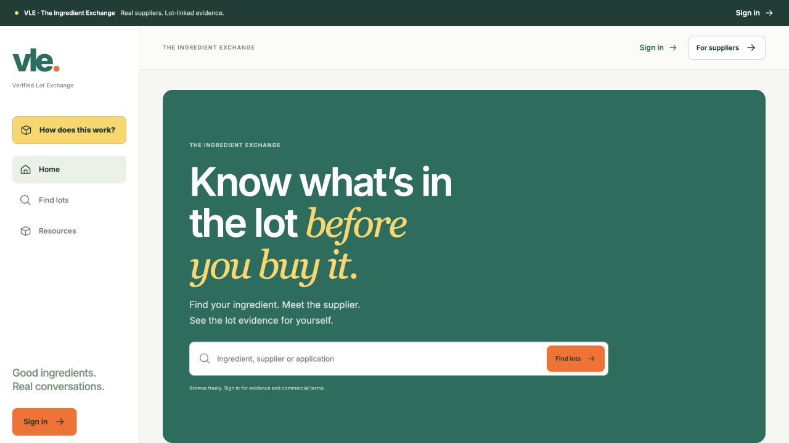
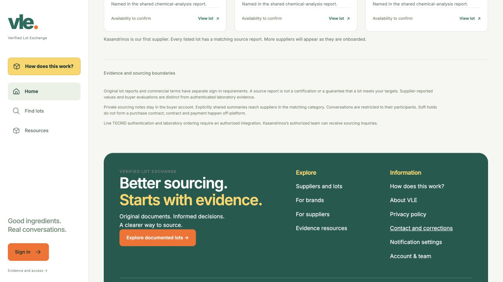

# VLE homepage verification

Checked the public https://vle.exchange/ homepage on October 25, 2026 in a fresh anonymous browser tab at 1280 by 720 pixels. The public HTML and assets were also fetched with curl without cookies.

Both VLE items in VLE-TECRID-LIVE-FIX-1 are already fixed in live Sites version 27. This PR adds regression checks and evidence on top of the source sync in PR #62. It makes no application, style, claim, disclosure or deployment changes.

| Item | October 24, 19:38 report | Current live result |
| --- | --- | --- |
| One job above the fold | Hero, search, Kasandrinos and two role cards shared the first screen | Headline, subline, search and Find lots fit in the first screen. Kasandrinos starts at y=748, below the 720px fold; role cards start at y=885 and y=990. |
| Sourcing boundaries | Label with no visible content | The details block starts expanded and displays all three existing paragraphs. It was collapsed, rather than empty or failing to render. |

The Site source commit was created on October 24 at 19:58:13 Asia/Nicosia, and version 27 deployed successfully at 20:00:53. Both occurred after the 19:38 report.





## Checks

Run from the repository root:

```sh
node tests/homepage-regressions.mjs docs/verification/2026-10-25/vle-live-layout.json
```

The test executes the actual anonymous browser entrypoint with a local bootstrap fixture and checks the rendered hero, card placement in the following section, expanded details and nonempty boundary paragraphs. It also validates the captured browser measurements: required hero controls fit within the first screen, all three cards are below it, and the unchanged boundary content has visible dimensions and styles. Mutation checks prove that card crowding, collapsed details, hidden content and empty content fail.

`passing-tests.txt` contains the exact passing output. `vle-live-layout.json` contains the read-only live DOM measurements. These are a dated observation, not a substitute for a fresh browser run when the layout changes.

To recapture, open the homepage anonymously at 1280px, evaluate the contents of `tests/homepage-browser-snapshot.js` through CUA `tab.playwright.evaluate`, save the returned JSON, then run the command above against that file. Save the first-screen screenshot and a screenshot after scrolling to the sourcing boundaries. The snapshot reads layout and content without changing the page. Without a snapshot argument, the test checks the currently checked-out application's render output.

Additional checks: `git diff --check` passed; all 230 original Site files remain byte-identical to source commit `d652dec902a094102698c8388294680d2ce51c8b`. The sync base passed all 12 existing test files and its production build.
