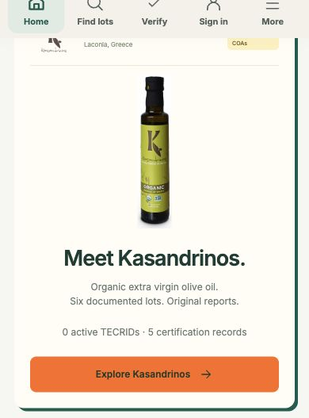
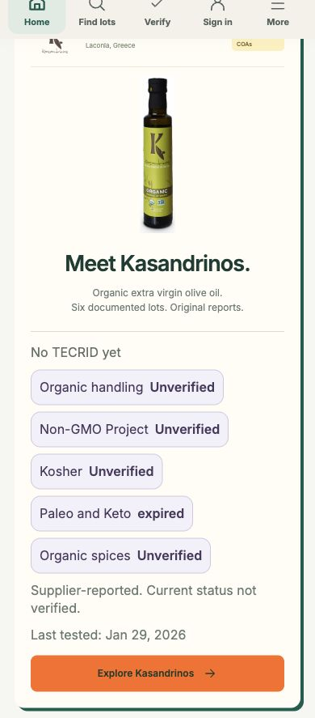
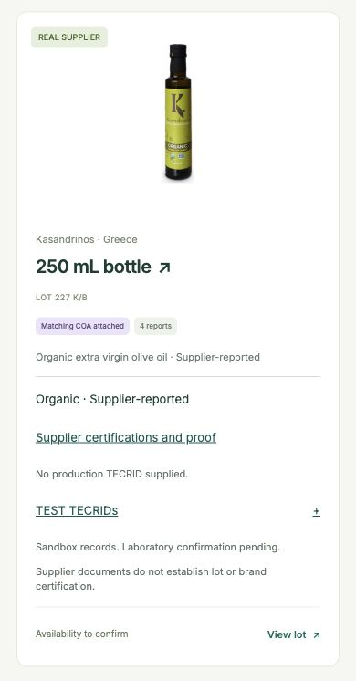
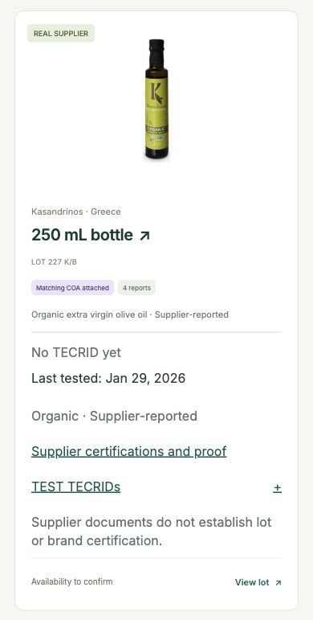
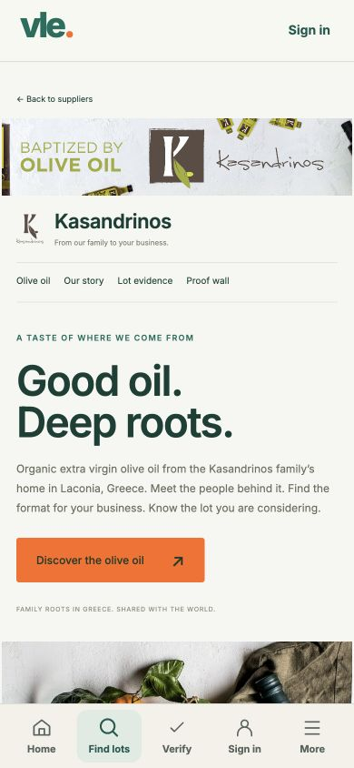
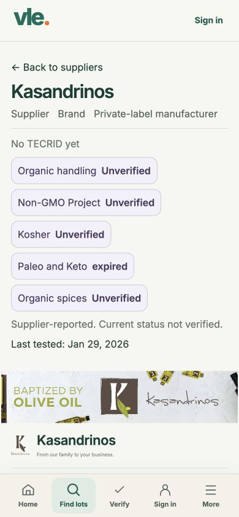

# VLE-PROOF-CHIPS-1

Separate branch `codex/vle-proof-chips-1`, based on main `10917e5a04a8ce59fac9f7547746d65424be84f9`. Part A is draft [PR #73](https://github.com/paleofoundation/VLE/pull/73). Elon gates and merges both PRs.

## Behavior

- Shared proof summaries appear on all six home/directory lot cards, featured storefront lots, all six storefront lot directory rows, sourcing candidate cards, submitted-lot cards, home/discovery supplier cards, and public organization and supplier profiles.
- Production TECRID chips show the existing ID and status and link directly to their public TECRID page in a new tab. Explicit `qualified`/`QUALIFIED` becomes `QUALIFIED`; missing status becomes `pending`. Existing active, expired, suspended, superseded and revoked states are retained. Active is not inferred to mean qualified. Lapsed freshness remains visible.
- Certification chips show the program and current status. `analytical-record` displays exactly `Lab result, not a certification`, including the detailed proof wall, and is excluded from the certification count. Chips link to the original scope details. Supplier-reported and historical/expired records remain labeled, and organization-only certificates are never attached to an oil lot.
- Empty public proof shows muted `No TECRID yet`, even when separate sandbox references exist. Existing TEST links remain in a separate disclosure with their IDs, `pending`, and `Sandbox`. They do not become production proof.
- Last-tested dates use only existing lot report-date metadata, with an American English date and machine-readable `time`. A supplier/brand summary uses the newest date among its existing public lots. Unknown dates say `Not provided`; issuance, import and certification dates are not substituted.
- Kasandrinos's Supplier, Brand and Private-label manufacturer roles and all five certification programs precede the storefront imagery. The public snapshot has no production TECRIDs, so it shows the honest empty state. The public organization page also starts with its proof summary. Brand pages use the same renderer and their own public projection.
- No backend, API, gating, authentication, database, schema, dependency or permission changes. The public bootstrap projection supplies all data; no new request or external read is needed. No merge or deployment. Plain push only.

## Validation

All 17 test files pass, including the new 192-check suite in `tests/proof-chips.mjs`. Coverage includes each TECRID/certification state, analytical program labels, empty/missing date states, scope isolation, invalid public links, escaping, actual application cards/profiles, sourcing candidates/submissions, and all role-tab sets. The original mobile-shell tests still cover More open/close, Escape, backdrop, navigation and desktop resize. [Test results](tests.txt).

Production build, JavaScript syntax checks and `git diff --check` pass. [Build log](build.txt). [Dash scan](dash-scan.txt): Part B adds zero literal or encoded em/en dashes. The seven baseline strings on main are removed by the independent copy-only PR #73, not duplicated here.

Integration suites initialize disposable Miniflare databases and stub external services. No application or production database was migrated or queried, and no real message was sent. The built Worker suite also passes with zero outbound calls.

Browser verification:

- 390 x 844 CSS px: supplier proof ends at y=605.39, above bottom tabs at y=773. All five certification targets are 44 px high and use 16 px text. No horizontal overflow.
- Long synthetic TECRIDs wrap inside the card; every chip stays at least 44 px high with 16 px text. QUALIFIED, pending, active/lapsed, revoked, analytical and empty states are visually checked in an isolated fixture.
- Organic spices chip opens its exact certificate detail, including `Ares Pepper and Zeus Blend only` and `Not evidence for olive oil`.
- Browser role switching through the existing synthetic fixture preserves signed-out, brand, supplier and member tab sets. More opens and closes.
- At 1280 x 900, phone tabs remain hidden, desktop proof remains visible, and both home and supplier pages have no horizontal overflow.
- [Browser measurements](browser-measurements.json). This is local browser QA, not a physical iPhone or live authentication check.

## Requested 390 px before and after screenshots

The full home captures are [before](home-before-390.jpg) and [after](home-after-390.jpg). The lookup hero is unchanged: [before](home-top-before-390.jpg), [after](home-top-after-390.jpg). The home supplier card is shown below so the proof change is easy to inspect.

| Surface | Before | After |
| --- | --- | --- |
| Home supplier card |  |  |
| Lot card |  |  |
| Supplier profile, first viewport |  |  |

Additional evidence: [organization before](organization-before-390.jpg), [organization after](organization-after-390.jpg), [synthetic chip states](synthetic-chip-states-390.jpg), [desktop supplier profile](supplier-desktop-after.jpg).

## Reproduce locally

Run `node scripts/preview-app-shell.mjs` for the existing read-only public snapshot fixture at `http://127.0.0.1:5187`. The screenshot fixture serves the actual frontend modules and the committed public projection snapshot: five source certification records, six lots, no production TECRIDs. Its role picker uses synthetic local accounts and does not authenticate a real user. Run `node scripts/preview-proof-chip-states.mjs` for the isolated synthetic layout cases at `http://127.0.0.1:5189`. Neither helper is a deployment entrypoint.

Before images were captured from unmodified main at 10917e5a. The additional close-up of the home supplier card was captured from Part A at 40b8feb, whose seven punctuation replacements do not alter this card. After images use Part B. All card crops retain the 390 px page width; viewport captures use 390 x 844.
